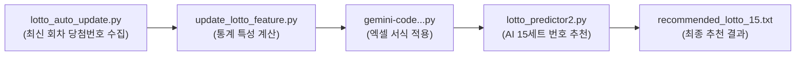

# 🎱 Lotto Predictor & Auto Runner (로또 번호 자동 수집 및 번호 예측 시스템)

동행복권 최신 당첨 번호를 자동으로 수집하고, 통계 및 머신러닝 기법을 활용하여 추천 로또 번호를 생성해 주는 자동화 프로젝트입니다.

---

## 🚀 빠른 시작 (원샷 실행)

윈도우 환경에서는 **`run_lotto.bat`** 파일을 더블클릭하면 0단계부터 3단계까지 자동으로 한 번에 실행됩니다.

1. `run_lotto.bat` 더블클릭 실행
2. 완료 후 생성된 `recommended_lotto_15.txt` 파일에서 추천 번호 확인

---

## 🛠️ 주요 기능 및 구성 파일

| 파일명 | 설명 |
| :--- | :--- |
| **`run_lotto.bat`** | 전체 파이프라인(0단계~3단계)을 한 번에 실행해 주는 원샷 배치 파일 |
| **`lotto_auto_update.py`** | 동행복권 API에서 최신 회차 당첨 번호를 수집하여 `lotto_data.xlsx` 업데이트 |
| **`update_lotto_feature.py`** | 로또 데이터 통계 칼럼 및 머신러닝 특성(Feature) 자동 계산 |
| **`gemini-code-1785640123148.py`** | 중복 번호 강조 및 엑셀 시각화 서식 적용 (`lotto_data_highlighted.xlsx`) |
| **`lotto_predictor2.py`** | 15세트(15,000원 예산) 머신러닝 기반 번호 추천 및 텍스트 파일 저장 |
| **`lotto_data.xlsx`** | 역대 로또 당첨 데이터 및 통계 엑셀 원본 파일 |
| **`recommended_lotto_15.txt`** | 최종 예측/추천된 15개 로또 번호 세트 결과 파일 |

---

## 📋 단계별 실행 설명

1. **STEP 0 (당첨번호 수집)**: 동행복권 API와 통신하여 최신 회차 번호를 누락 없이 엑셀에 추가합니다.
2. **STEP 1 (통계 계산)**: 출현 빈도, 연속 번호, 합계 등 예측에 필요한 데이터를 분석합니다.
3. **STEP 2 (엑셀 서식)**: 엑셀 파일에서 중요한 번호와 중복 번호를 한눈에 볼 수 있도록 하이라이트합니다.
4. **STEP 3 (번호 추천)**: 15세트의 최적 조합 번호를 생성하여 텍스트 파일로 출력합니다.
